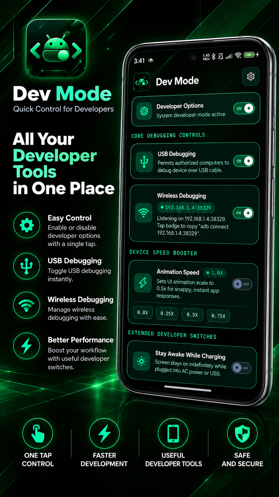
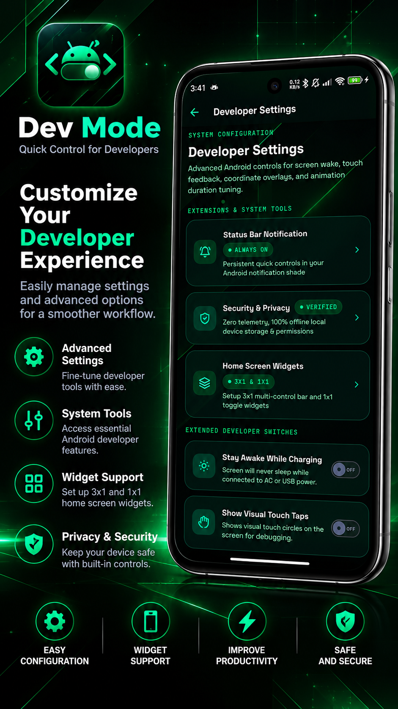
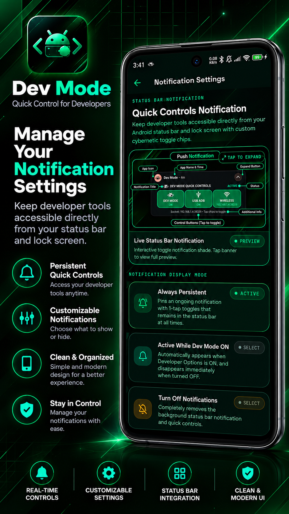
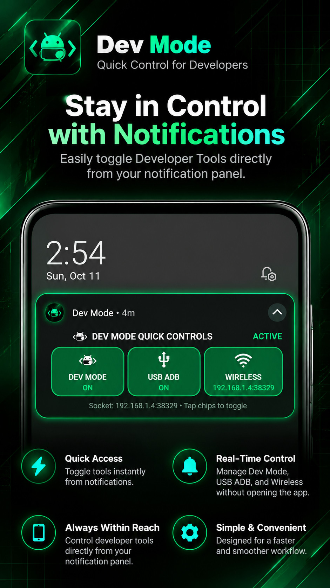
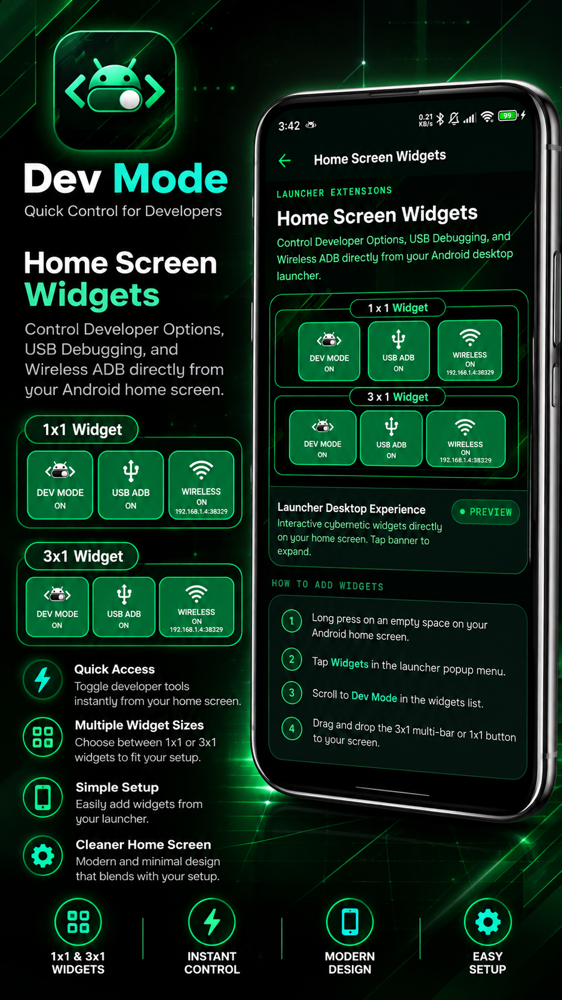
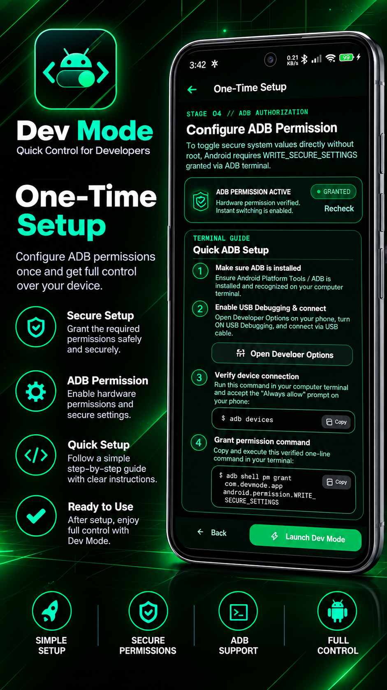
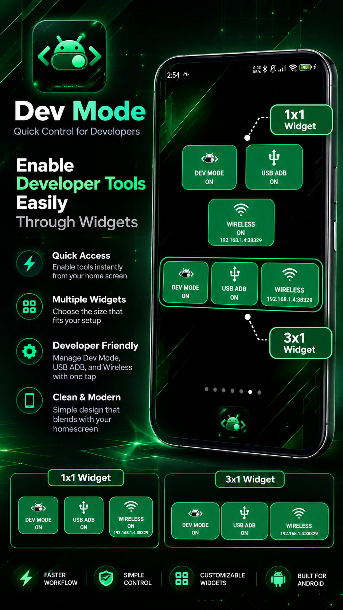

<div align="center">

  <h1>🚀 Dev Mode ⚡</h1>

  <p><strong>The Ultimate Rootless Android Developer Options & Quick-Toggle Utility</strong></p>

  <p>
    <a href="https://android.com"></a>
    <a href="https://expo.dev"></a>
    <a href="https://kotlinlang.org"></a>
    <a href="#-license--attribution"></a>
  </p>
  <p>
    <a href="https://github.com/Ryderhxrzy/Dev-Mode-Mobile"></a>
    
    
    
  </p>

  <p>
    A high-performance Android utility built for developers, power users, and modders to instantly toggle Developer Options, ADB Debugging, and System Performance scales without navigating deep into Android Settings.
  </p>

</div>

---

## ⚡ Quick Start

New here? Three steps, about five minutes:

1. **Install the app.** Download the APK from the [Releases page](https://github.com/Ryderhxrzy/Dev-Mode-Mobile/releases) and open it on your phone. [Details](#-install)
2. **Grant the permission once.** Connect your phone to a computer by USB, then run:
   ```bash
   npm install -g dev-mode-cli
   devmode grant
   ```
   [Other ways, and what this permission does](#-one-time-setup-permission-grant)
3. **Use it.** Toggle Developer Options, USB Debugging and Wireless Debugging from the app, the home screen widgets or the notification bar.

### Requirements

| You need | Details |
| :--- | :--- |
| **Android** | 7.0 (API 24) or newer |
| **Wireless Debugging toggle** | Android 11 or newer. Android added this setting in version 11. The Developer Options and USB Debugging toggles work on 7.0 and up. |
| **Root** | Not needed |
| **A computer, once** | Only to grant the permission (Windows, macOS or Linux, with a USB cable). You do not need it afterwards. |
| **For the CLI method** | [Node.js](https://nodejs.org) 16+ and Android Platform Tools (`adb`) |
| **Internet** | Not needed to use the app |

---

## 📸 App Screenshots

<div align="center">

| 📱 Dashboard & Controls | ⚙️ Developer Settings | 🔔 Notification Settings |
| :---: | :---: | :---: |
|  |  |  |
| **Core Hardware Controls** | **Advanced Dev Options** | **Notification Shade Modes** |
| 1-tap Dev Options, USB & Wireless ADB | Stay awake, touch taps & scales | Always on & dynamic triggers |

<br />

| 🔔 Push Notification Persistent | 📲 Home Screen Widgets | 💻 One-Time ADB Setup |
| :---: | :---: | :---: |
|  |  |  |
| **Persistent Notification Shade** | **Desktop Launcher Widgets** | **Step-by-Step Authorization** |
| Live status bar quick toggle chips | 3x1 multi-bar & 1x1 toggle buttons | 1-time setup via PC or Shizuku |

</div>

---

## ✨ Features Overview

| Category | Feature | Description | System Target / Scope | Rootless? |
| :--- | :--- | :--- | :--- | :---: |
| **Core Debugging** | **Master Developer Options** | Instant 1-tap toggle for Android's system developer mode without navigating deep into Settings menus. | `development_settings_enabled` | ✅ Yes |
| **Core Debugging** | **USB Debugging** | Fast direct toggle allowing authorized PC debugging over physical USB cable. | `adb_enabled` | ✅ Yes |
| **Core Debugging** | **Wireless ADB Debugging** | Wi-Fi ADB toggle with live dynamic IP:port socket display and 1-tap clipboard copy pill. | `adb_wifi_enabled` + port polling | ✅ Yes |
| **Core Debugging** | **Keep Wireless On** | Android switches Wireless Debugging off every time Wi-Fi drops. Dev Mode turns it back on automatically when Wi-Fi returns (toggle in Developer Settings, on by default). | Wi-Fi network callback | ✅ Yes |
| **Performance** | **Device Speed Booster** | Direct 1-tap boost setting Window, Transition, and Animator scales to **0.5x** for instant UI responses. | UI Duration Multipliers | ✅ Yes |
| **Performance** | **Custom Animation Scales** | Fine-grained tuning presets: Off (0.0x), Ultra Fast (0.25x), Snappy (0.5x), Standard (1.0x), Relaxed (1.5x). | Window / Transition / Animator | ✅ Yes |
| **System Tools** | **Stay Awake While Charging** | Keeps the device screen illuminated indefinitely while connected to AC power or USB. | `stay_on_while_plugged_in` | ✅ Yes |
| **System Tools** | **Show Visual Touch Taps** | Displays visible circular touch tap highlights on screen for screen recording and UI review. | `show_touches` | ✅ Yes |
| **System Tools** | **Pointer Location Tracker** | Overlays real-time screen touch coordinates, pressure, and crosshair tracker data. | `pointer_location` | ✅ Yes |
| **Launcher Widgets**| **3x1 Multi-Control Widget** | Horizontal desktop widget for Developer Options, USB ADB, and Wireless ADB with live status indicators. | Native `AppWidgetProvider` | ✅ Yes |
| **Launcher Widgets**| **1x1 Single Button Widgets** | Independent square widgets for Dev Mode, USB ADB, or Wireless ADB for customizable home screen layouts. | Native RemoteViews broadcast | ✅ Yes |
| **Status Bar Bar** | **Quick Controls Notification** | Ongoing Android notification shade bar featuring interactive 1-tap toggle chips for instant access. | Android Notification Shade | ✅ Yes |
| **Maintenance** | **Instant Cleanup** | 1-tap restoration that resets all animation scales to 1.0x, disables overlays, and wipes local preferences. | System Reset & Local Preferences | ✅ Yes |
| **Privacy & Sec** | **Zero Telemetry** | 100% offline, zero trackers, zero cloud storage, no account required, and fully revocable permissions. | Local Device Exclusive | ✅ Yes |

---

## 📲 Home Screen Widget Setup

<div align="center">
  
  <p><em>Zero-latency 1x1 & 3x1 widgets on Android desktop launcher with real-time sync.</em></p>
</div>

Dev Mode offers both a comprehensive **3-in-1 multi-control bar** and individual **1x1 standalone widgets**:

1. **Long-press** any empty space on your Android home screen.
2. Tap **Widgets** in the launcher popup menu and scroll to **Dev Mode**.
3. Choose your preferred format:
   - **3-in-1 Quick Toggle (3x1)**: Access Developer Options, USB Debugging, and Wireless ADB side-by-side.
   - **Dev Mode (1x1)**: Dedicated single button for Developer Options.
   - **USB Debugging (1x1)**: Dedicated single button for USB ADB.
   - **Wireless ADB (1x1)**: Dedicated single button for Wireless ADB.
4. Drag and drop the widget onto your home screen. Tapping tiles toggles system states instantly in the background without needing to launch the full app.

---

## 📥 Install

1. Open the [Releases page](https://github.com/Ryderhxrzy/Dev-Mode-Mobile/releases) and download the latest APK:
   - **`app-arm64-v8a-release.apk`**: for almost every phone made in the last several years (about 35 MB).
   - **`app-armeabi-v7a-release.apk`**: only for older 32-bit phones (about 29 MB).
2. Open the downloaded file. When Android asks, allow **Install unknown apps** for your browser or file manager.
3. Open **Dev Mode** and follow the onboarding. The last step is the one-time permission grant below.

> Not sure which APK? Pick `arm64-v8a`. If Android says the app is not compatible, use `armeabi-v7a`.

Updates are manual: download the newer APK and install it over the old one. Your settings stay, because every release is signed with the same key.

**Optional: verify your download.** Compare the SHA-256 of the file with the checksum in the release notes (PowerShell):

```powershell
Get-FileHash .\app-arm64-v8a-release.apk -Algorithm SHA256
```

---

## 🚀 One-Time Setup (Permission Grant)

Changing Android developer settings needs a permission that only a computer can grant. Do this once per install. Pick **one** of the two ways below.

### Prerequisites
1. Turn on **Developer Options** and **USB Debugging** on your phone once (Settings → About phone → tap *Build number* 7 times).
2. Connect the phone to your computer with a USB cable and tap **Always allow** on the phone.

### Option A: Dev Mode CLI (recommended)

The [Dev Mode CLI](https://github.com/Ryderhxrzy/Dev-Mode-CLI) finds your phone and grants the permission for you. It needs [Node.js](https://nodejs.org) 16+ and Android Platform Tools (`adb`).

```bash
# Install once. The package is named dev-mode-cli, the command it adds is devmode
npm install -g dev-mode-cli

# Grant the permission
devmode grant
```

Prefer not to install anything? Run it once with `npx`:

```bash
npx dev-mode-cli grant
```

> Use `npx dev-mode-cli`, not `npx devmode`. On npm, `devmode` is a different, unrelated package.

The same CLI also controls the app from your PC. Open its one-key menu with `devmode auto`, or run commands directly:

```bash
devmode on            # Developer Options ON
devmode usb on        # USB Debugging ON
devmode wifi on       # Wireless Debugging ON and auto-connect over Wi-Fi
devmode status        # Show device status
```

### Option B: Manual ADB

```bash
adb shell pm grant com.devmode.app android.permission.WRITE_SECURE_SETTINGS
```

> **Using Shizuku?** You can also authorize the permission directly on-device using [Shizuku](https://shizuku.rikka.app/) without needing a PC connection.

### Check it worked
The onboarding screen and the **Security** screen show **GRANTED** once the permission is active. Tap **Recheck** if it still says pending.

### What the permission does

`WRITE_SECURE_SETTINGS` is an Android permission that lets an app change protected system settings. Android has no button to grant it, so it is granted once from a computer.

**Dev Mode uses it only to change these settings:**
- Developer Options on or off
- USB Debugging on or off
- Wireless Debugging on or off
- Animation scales (window, transition, animator)
- Stay awake while charging, show touches, pointer location

**It does not give Dev Mode root access.** It does not let the app read your files, photos, messages or other apps.

To be fully transparent: technically this permission allows writing any protected setting. Dev Mode only changes the ones listed above, and all of the code is in this repository so you can check it.

**Permissions the app asks for, and why:**

| Permission | Why |
| :--- | :--- |
| `WRITE_SECURE_SETTINGS` | Change the developer settings listed above. Granted by you from a computer. |
| Notifications | Show the notification bar with quick toggles. Optional. |
| Foreground service | Keep the notification and the local Wi-Fi bridge alive in the background. |
| Network and Wi-Fi state | Show your phone's Wi-Fi IP and Wireless Debugging port, and let your computer talk to the app over your own network. |

You can undo the permission at any time, see **Revoking Permission** below.

### Revoking Permission

You keep full control. Revoke it any time from your computer:

```bash
adb shell pm revoke com.devmode.app android.permission.WRITE_SECURE_SETTINGS
```
*(or simply uninstall the application).*

> If you reinstall or clear the app, run the grant command again.

---

## 🧰 Troubleshooting

**The app still says the permission is pending after I ran the command.**
Run `adb devices` on your computer. Your phone should be listed as `device`. If it says `unauthorized`, unlock the phone and tap **Allow** on the "Allow USB debugging?" prompt. Then run the grant command again and tap **Recheck** in the app.

**`adb` or `devmode` is not recognized.**
Install [Android Platform Tools](https://developer.android.com/tools/releases/platform-tools) and add the folder to your PATH. For `devmode`, install Node.js first, then run `npm install -g dev-mode-cli`. Open a new terminal window afterwards.

**Which command do I use, `devmode` or `dev-mode-cli`?**
Install with the package name, run with the short command: `npm install -g dev-mode-cli`, then `devmode grant`. If you do not want to install it, use `npx dev-mode-cli grant`. Do not use `npx devmode`, because `devmode` on npm is a different, unrelated package.

**Wireless Debugging turns itself off when my Wi-Fi drops.**
That is Android's behavior. Dev Mode can turn it back on when Wi-Fi returns: open **Developer Settings** in the app and enable **Keep Wireless Debugging On**.

**Wireless Debugging will not turn on.**
It needs Android 11 or newer and a connected Wi-Fi network. The first time on a new network, Android may ask you to approve it in its own **Wireless debugging** screen.

**"App not installed" or "conflicts with an existing package".**
A copy signed with a different key is already on the phone, for example an older test build. Uninstall it, then install the release APK. You will need to run the grant command again.

**Play Protect warns about the app.**
Android shows this for any app installed from outside the Play Store. You can compare your download with the SHA-256 checksum in the release notes before choosing **Install anyway**.

**I reinstalled or cleared the app and the toggles stopped working.**
The permission belongs to the installation. Run the grant command again.

---

## 🛠️ Development & Building

The project is built using **Expo (React Native)** with a custom native Kotlin module located in `modules/dev-toggle-native/`.

### Prerequisites
- Node.js 18+
- Android SDK (API 34+) & JDK 17

### Local Setup

```bash
# Install dependencies
npm install

# Run TypeScript type check
npx tsc --noEmit

# Run code linter
npx expo lint

# Build & launch on connected Android device
npx expo run:android
```

### Release Builds (signed APK)

Release builds are signed with your own keystore. Create `android/keystore.properties` (git-ignored) next to your `.jks` file:

```properties
storeFile=devmode-release.jks
storePassword=YOUR_PASSWORD
keyAlias=devmode
keyPassword=YOUR_PASSWORD
```

`storeFile` is resolved from `android/app/`. Without this file the release build falls back to the debug key, so a fresh clone still builds, but that APK is not suitable for publishing.

```bash
cd android
./gradlew assembleRelease     # Windows: .\gradlew.bat assembleRelease
```

Output: `android/app/build/outputs/apk/release/` with one APK per CPU architecture (`arm64-v8a`, `armeabi-v7a`). Release builds use R8 code shrinking and resource shrinking to keep the download small.

> **Never commit or lose the keystore.** Back up the `.jks` file and its password. Without the same key you cannot publish updates that install over existing installs.

### Publishing a release

Keep three things in step for every release:

| Where | Example |
| :--- | :--- |
| Git tag | `v1.2.0` |
| `versionName` in `android/app/build.gradle` (and `version` in `app.json`) | `1.2.0` |
| `versionCode` in `android/app/build.gradle` | higher than the previous release |

Android refuses to install an APK whose `versionCode` is the same or lower than the installed one, so always increase it.

```bash
gh release create v1.2.0 \
  android/app/build/outputs/apk/release/app-arm64-v8a-release.apk \
  android/app/build/outputs/apk/release/app-armeabi-v7a-release.apk \
  --title "Dev Mode v1.2.0" --notes "What changed"
```

### Cloud Builds with EAS

```bash
# Development build
npx eas-cli@latest build --platform android --profile development

# Production APK / AAB
npx eas-cli@latest build --platform android --profile production
```

---

## 🤝 Contributing & Pull Requests

Contributions, feedback, and pull requests are welcomed!

- **Fork the Repository**: Feel free to fork the project and adapt it for your workflow.
- **Give Credit**: If you use this codebase or build upon it, please provide attribution and a link back to this repository.
- **Submit Pull Requests**: Check out open issues or propose new developer utilities through a PR.

---

## 📄 License & Attribution

This project is open-source software licensed under the **[MIT License](LICENSE)**.

**Copyright © 2026 Jhayr Cervantes ([GitHub: @Ryderhxrzy](https://github.com/Ryderhxrzy))**

### Redistribution & Attribution Terms
Under the MIT License, you are free to use, modify, and distribute this software for personal or commercial projects, provided that:
- You **must retain** the original copyright notice and permission notice in all copies or substantial portions of the software.
- Credit is given to the author (**Jhayr Cervantes** / **@Ryderhxrzy**).

### Third-Party Acknowledgments
- **Expo & React Native**: Copyright (c) 650 Industries, Inc. (Licensed under MIT).
- **Lucide Icons**: Copyright (c) Lucide Contributors (Licensed under ISC).
